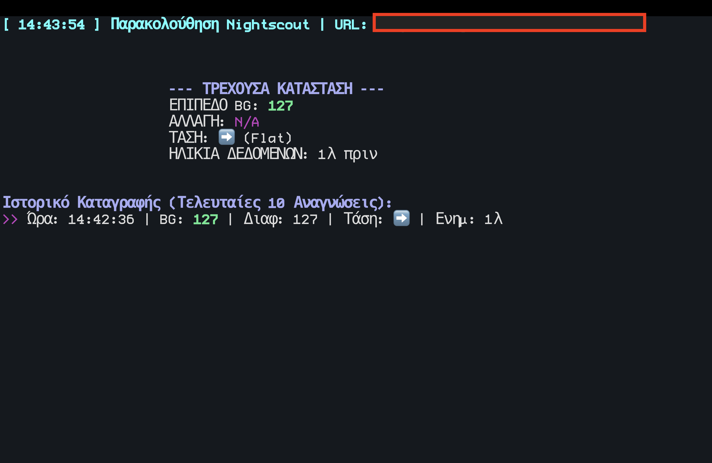

# 🚀 Nightscout Terminal Dashboard



## Backstory

Two years ago, my daughter was diagnosed with Type 1 Diabetes. From day one, I began searching for a way to monitor her blood glucose levels directly from my MacBook's terminal. I couldn't find a tool that truly fit my need for a quick, minimal, and constantly visible status, so I decided to create this project.

This dashboard is a lightweight, always-on utility designed to provide immediate peace of mind by showing the most critical Nightscout data right in the command line. Any suggestion for improvement is highly welcomed!

## What it does

A small command-line tool for macOS and Linux that shows live blood glucose from your Nightscout site in the terminal, the menu bar, or tmux.

- **Big, color-coded number** you can read from across the room, with the trend arrow and the change over the last 5 minutes.
- **Five levels:** urgent low, low, in range, high and urgent high, each with its own color.
- **Stale data warning:** if the newest reading is older than 15 minutes, the number turns grey and a red "NO RECENT DATA" banner appears.
- **Desktop alerts with sound** (macOS notifications, `notify-send` on Linux) for lows, highs, falling fast and stale data. An ongoing alert repeats every 15 minutes. Press `m` to mute.
- **Graph of the last 3 hours** with the target range marked.
- **Time in range for the last 24 hours**, plus % low, % high, average glucose and GMI.
- **IOB / COB** (insulin and carbs on board) if your site has them (Loop, AAPS, OpenAPS).
- **mg/dL or mmol/L**, switch at any time with `u`.
- **English and Greek** (`--lang gr`).
- **Menu bar mode** for [SwiftBar](https://swiftbar.app) and a **one-line mode** for tmux or your shell prompt.
- Smooth redraw (no flicker), adapts to the window size, and the clock and "minutes ago" update every second.

## Installation

You need `curl` and `jq`. On macOS:

```bash
brew install jq
```

Then:

```bash
git clone https://github.com/tsakmas/Nightscout-Terminal-Dashboard.git
cd Nightscout-Terminal-Dashboard
cp nightscout.conf.example nightscout.conf
nano nightscout.conf        # fill in NIGHTSCOUT_URL and TOKEN
./nightscout.sh
```

Use a **read-only** token (Nightscout → Admin Tools → Subjects, role `readable`).
`nightscout.conf` is in `.gitignore`, so your token is never committed. You can also keep the file at `~/.config/nightscout-dash.conf`, or use the environment variables `NS_URL` and `NS_TOKEN`.

## Usage

```bash
./nightscout.sh                       # full-screen dashboard
./nightscout.sh --lang gr --units mmol
./nightscout.sh --line                # one line, e.g. "142 ↗ +4"
./nightscout.sh --help                # all options
```

Keys in the dashboard: `q` quit · `r` refresh now · `u` switch units · `m` mute alerts

### Menu bar (macOS)

1. Install SwiftBar: `brew install --cask swiftbar`
2. Copy `swiftbar/nightscout.30s.sh` into your SwiftBar plugin folder.
3. If you cloned the project somewhere other than `~/Nightscout-Terminal-Dashboard`, change `NS_DIR` at the top of that file.

The menu bar shows `142 ↗ +4` in green, orange or red, and alerts also work from there.

### tmux status bar

```tmux
set -g status-right '#(~/Nightscout-Terminal-Dashboard/nightscout.sh --line)'
set -g status-interval 30
```

## Settings

All settings are in `nightscout.conf` (see `nightscout.conf.example`): language, units, refresh interval, stale time, the four thresholds (always in mg/dL), alerts and alert repeat time.

## Previous version

The original version (with `gr_nightscout.sh`, `en_nightscout.sh` and the `get_millis` C helper) is kept under the git tag `v1`:

```bash
git checkout v1
```

## License

This project is licensed under the MIT License.
